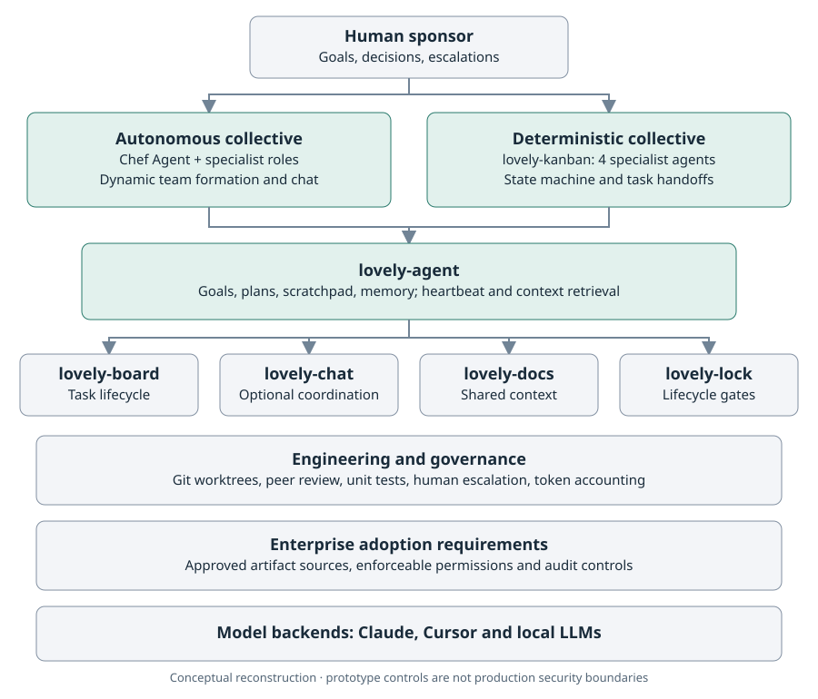

[Back to home](../)

# Lovely Collective

**Build to learn. Adopt to scale. Govern by design.**

*Hands-on exploratory R&D · May–June 2026*

## Why I built it

How can engineering teams adopt agentic software development without losing engineering discipline, security or human accountability?

I wanted to develop first-hand technical intuition, not just evaluate vendor demos or produce another competing platform. I invested substantial time in AI-assisted engineering, building small working prototypes to understand the trade-offs and limitations of existing approaches to agent orchestration and their applicability in regulated enterprise environments.

This was a personally initiated, local-workstation experiment using a synthetic software project. It did not use any employer's internal source code, and was not an official company-wide programme or a production deployment. The purpose was to inform a possible adoption playbook and demonstrate the concepts to engineering teams and leadership.

## Two approaches to orchestration

*Conceptual reconstruction of my experimental design, not an enterprise production architecture.*

| | Autonomous collective | Deterministic collective |
|---|---|---|
| Team | Eight agents, including a coordinating Chef Agent and specialist roles | Four agents: PM, architect, coder and reviewer |
| Coordination | Dynamic team formation, chat, shared board and documents | Kanban state machine and role-specific task handoffs |
| Best fit (my hypothesis) | Ambiguous work, diagnostics and self-improvement | Established software development workflows |
| Trade-off | More flexible, potentially more coordination overhead | More predictable workflow and potentially lower coordination cost |

Both prototypes were able to take a representative development epic from a human request through design and implementation on a synthetic codebase when backed by sufficiently capable models. This was an exploratory result, not a controlled benchmark.

## Keeping the implementation simple

I built independently usable Python components with REST APIs, CLIs and lightweight web interfaces. Agents used a heartbeat to wake and retrieve relevant context; file-change hooks supported chat updates. Coding agents used Git worktrees. Structured goals, plans, scratchpads and persistent context helped keep work focused, while intermediate artifacts underwent peer review and code was accompanied by unit tests.

The orchestration ran locally; model inference was not necessarily local. I used Claude Code and Cursor alongside experiments with smaller local open models. The latter were useful for some implementation tasks but generally inadequate for substantive epics in my experiments.

## Governance is part of the workflow

A task lifecycle is more than a sequence of coding steps. Agents need to know their authority and when to stop.

- **Human escalation:** the `lovely-lock` utility could block task progression or changes at different stages, not only code merges. For example, a PM agent could lock a task when a proposed outcome required human review.
- **Organizational context:** shared beliefs, boundaries, team charter and working agreements helped agents make decisions within their remit.
- **Engineering and supply-chain security:** coding agents must follow the approved engineering system and security policies. In an enterprise adoption design, binaries and dependencies should be obtained only from approved internal artifact repositories, not directly from external sources.
- **Cost and quality:** agents recorded token usage and elapsed time; peer reviews and tests provided feedback.

These were prototype-level controls combining software checks and agent instructions. Production adoption would require independently enforced permissions, approved artifact access, isolated execution, reliable task claiming and recovery, audited actions, independent evaluation and hard resource limits. Prompt instructions are not a security boundary.

## What I learned

**Use deterministic orchestration when the process is known; use agentic orchestration when the process itself needs to be discovered.**

My qualitative judgment was that a Kanban state machine was economically more appropriate for a well-defined SDLC, whereas a coordinating agent was potentially useful for less-defined work and diagnosing or improving the collective itself. A hybrid approach is a promising direction, not a third implemented prototype.

The experience also reinforced that model selection, governance, and change management matter as much as code generation. I did not attempt to establish production reliability, validate enterprise compliance, or measure organization-wide productivity gains.

## From experimentation to adoption

I intended to use these learnings and a working demonstration to inform a third-party tooling adoption playbook. Later, I completed [MIT Sloan's Implementing Agentic AI: Building Your Organizational Playbook](https://executive.mit.edu/course/implementing-agentic-ai/a05U100000CvoPOIAZ.html) to complement practical experience with organizational design, governance and adoption foundations.

The proposed adoption programme was not delivered. The value of the experiment was the technical intuition and architectural questions it surfaced.

See also my [Strategic Brief Agent design case study](../strategic-brief-agent/), which applies agentic AI to strategic sensing and leadership decision preparation.

## References and further reading

The following public projects are useful context for the broader agentic tooling landscape; the links point to their current public versions, not necessarily the versions available during my experiments.

- [Paperclip](https://github.com/paperclipai/paperclip) — agent work orchestration.
- [Hermes Agent](https://github.com/NousResearch/hermes-agent) — agent runtime and tools.
- [OpenClaw](https://github.com/openclaw/openclaw) — personal agent tooling.
- [Agent Orchestrator (AI Kanban)](https://github.com/OrchestratorInc/agent-orchestrator) — a reference for Kanban-based agent orchestration.
- [Vibe Kanban](https://github.com/BloopAI/vibe-kanban) — additional reference for managing AI coding workflows.
- [MIT Sloan Executive Education: Implementing Agentic AI](https://executive.mit.edu/course/implementing-agentic-ai/a05U100000CvoPOIAZ.html).

[Back to home](../)
