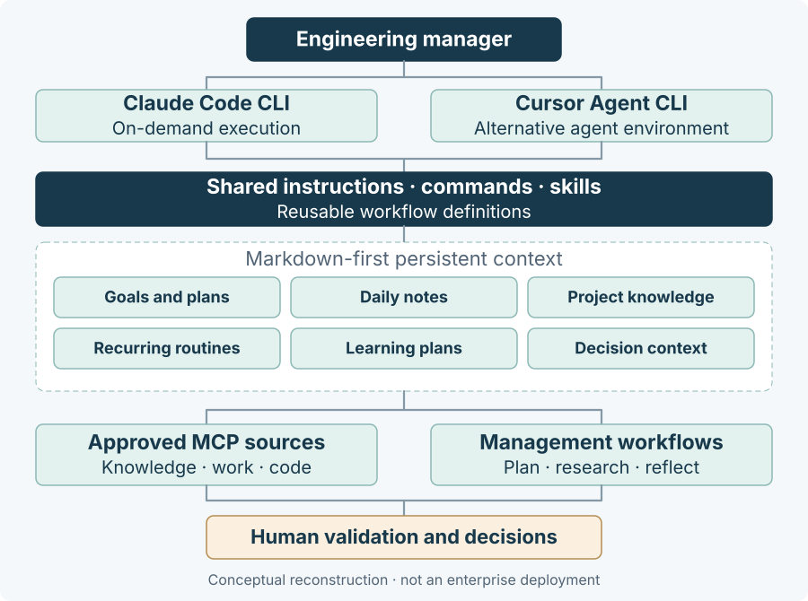
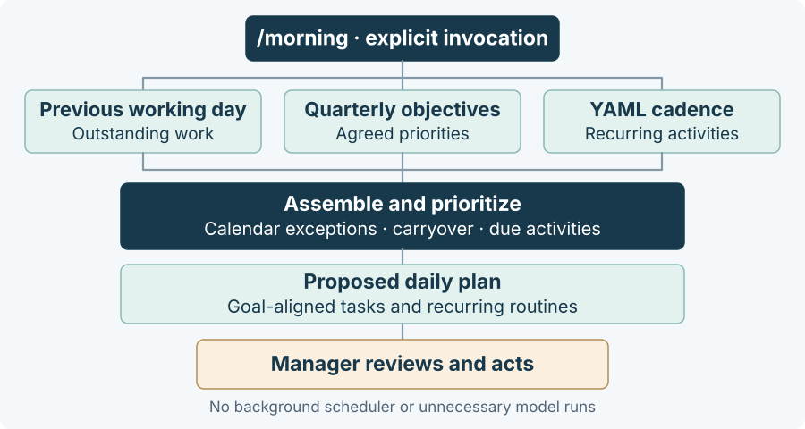
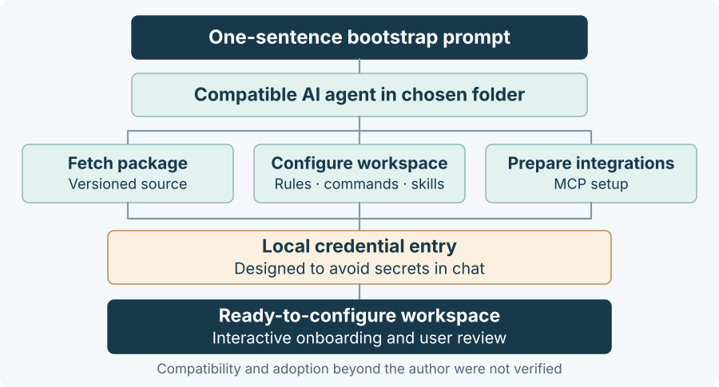

[Back to home](../)

# Lovely Notes

**Align priorities. Preserve context. Make better-informed decisions.**

*Personally developed and used in daily management work · August 2025–November 2026*

## Why I built it

Engineering management involves moving between fragmented knowledge, changing priorities, recurring responsibilities and decisions that require historical context. I wanted a lightweight workspace that would help me prepare for these responsibilities without introducing another complex application.

I started with structured Markdown notes in my first week in a new engineering management role, then incrementally developed the workspace with AI assistance. It became a practical, human-led management system rather than an experiment in maximum autonomy.

## Architecture: durable context, interchangeable intelligence

*Sanitized conceptual reconstruction, not an internal company architecture.*

The persistent context was ordinary, human-readable Markdown: goals, daily notes, project knowledge, plans and reusable management workflows. AI agents operated over this context through shared rules, commands and skills. I initially used Cursor and later primarily Claude Code CLI, with synchronized workflow definitions so I could switch environments.

Approved Model Context Protocol (MCP) integrations provided access to permitted knowledge, work tracking and source-control information. Source references and cross-checks were part of the reasoning workflow. Semantic links, text search and on-demand consistency audits supported knowledge maintenance.

The key design choice was simplicity: portable state, reusable workflows and minimal infrastructure.

## Daily planning with /morning

A user-triggered command found the previous working day, carried forward unfinished work, prioritized tasks against agreed goals and added recurring activities from a simple cadence configuration. I reviewed the resulting plan.

I deliberately avoided background scheduling. Human initiation meant the workflow ran when useful, rather than consuming model tokens on days when no planning was needed.

Other applications included source-backed historical research, preparation for management discussions, initiative tracking and structured personal development plans. Independent research tasks could run concurrently.

## Practical value

The following are **retrospective personal estimates**, not measured benchmarks or controlled comparisons.

| Preparation activity | Estimated manual time | AI-assisted time (recalled) |
| --- | ---: | ---: |
| Daily planning | 15 minutes | 1 minute |
| Own quarterly reflection | 2 hours | 10 minutes |
| Historical project research | 2 hours | 5 minutes |
| Management meeting preparation | 15 minutes | 1 minute |

These figures illustrate perceived personal productivity improvements. They do not establish realized organizational savings, quality equivalence or end-to-end verification time. I do not extrapolate them to team-wide ROI.

## From personal workflow to adoption

In spring 2026 I presented the approach to engineering and product leadership and prepared a reusable, single-prompt onboarding package. A capable agent could retrieve the package, prepare a generic workspace, configure reusable workflows and guide the user through integration setup. The design called for local credential entry rather than putting secrets into chat.

The aim was to lower the initial adoption barrier. I do not know whether others adopted the package, and compatibility across all agent environments was not verified. The experience reinforced that technical readiness and ease of installation do not by themselves establish organizational readiness.

## Governance and lessons learned

I used permitted corporate AI tools, approved MCP tooling and approved dependency sources. Access was selectively granted and source-backed reasoning was encouraged. Human judgment remained central. These choices do not establish audited compliance or authorization for every data category.

The largest limitation was fragmented approved integration coverage. If I were designing the next version, I would separate strictly private context from collaboration-safe knowledge, enforce access boundaries outside prompts, validate configuration and credential handling, and evaluate comparable task quality and time with a small voluntary pilot.

No confidential company data, employee records, internal configurations or source materials are reproduced here.

## The bigger picture

Lovely Notes is evidence of sustained personal AI adoption in engineering management. It complements [Lovely Collective](../lovely-collective/), which explored agentic engineering execution through working research prototypes, and [Strategic Brief Agent](../strategic-brief-agent/), a conceptual design for strategic sensing and human-owned decisions. These were distinct initiatives, not an integrated deployed platform.

[Back to top](https://shulgaalexey.github.io/)
