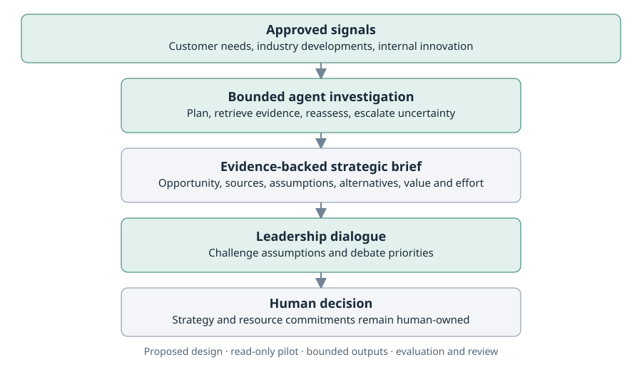

[Back to home](../)

# Strategic Brief Agent

**Better strategic sensing. Better-informed human decisions.**

*Conceptual design and adoption playbook · 2026 · Not implemented*

## The strategic problem

A strategy is not static. Leaders need to notice emerging uncertainties, challenge assumptions and create opportunities for debate before allocating scarce engineering and product resources.

## From management capstone to agentic AI playbook

The starting point was a formal management exercise, not a technology demonstration. In my October 2026 capstone for [Harvard Business School Online's Strategy Execution course](https://online.hbs.edu/courses/strategy-execution/), I applied the four perspectives on strategy and the levers of control to an engineering organization. I identified its Interactive Control System as an area for improvement and proposed a lightweight, leadership-driven mechanism for exploring strategic uncertainties.

The original proposal brought together three categories of signals: customer experience and competitive pressure, employee engagement and innovation, and delivery progress and quality. A regular leadership dialogue would ask what had changed, why it had happened, and what the organization should do about it. Each review would produce or update strategic hypotheses, decisions and accountable owners. The intention was to build on existing management tools rather than introduce another performance scoreboard.

During [MIT Sloan's Implementing Agentic AI programme](https://executive.mit.edu/course/implementing-agentic-ai/a05U100000CvoPOIAZ.html), I developed this management proposal further into the Strategic Brief Agent adoption playbook. The agent would proactively gather and investigate evidence, surface emerging uncertainties and prepare recommendations for that same interactive leadership dialogue. It would augment the control system, not replace human strategic judgment.

The progression was deliberate: diagnose the management problem, design the organizational process, then explore how agentic AI could strengthen it.

This is a generalized account of my course design work, not an operational system or a disclosure of company-specific data.

## The proposed workflow

The agent would monitor a bounded set of approved information sources, detect potentially important changes, decide what evidence to investigate next, and prepare a concise strategic brief or escalate unresolved uncertainty.

An effective brief would describe the opportunity or uncertainty, supporting evidence and sources, alternative interpretations, assumptions, potential value and effort, and unresolved questions.

**The agent prepares the decision; leaders make the decision.** Product and engineering leaders remain responsible for prioritization, strategy changes and resource commitments.

## Designing the authority boundary

I proposed a sandboxed initial workflow with read-only access to approved information sources, bounded outputs, auditable evidence, and explicit human escalation. The agent would choose its research path within permitted sources, while uncertain consequential decisions would receive human review. Organizational policies and permissions would remain under human control.

The agent would not autonomously commit resources, change strategy or create work in operational systems during the initial pilot.

## Evaluating the proposal

The design included a time-boxed pilot, iterative human reviews and a retrospective replay of historical signals. Evaluation would consider:

- Evidence quality, strategic relevance and coverage of approved source categories.
- Important signals missed or incorrectly discarded, including review of negative results.
- Source-retrieval failures, decision-preparation time, human review effort and operating cost.
- Downstream value relative to the product, architecture and engineering effort invested, as a longer-term measurement hypothesis.

Historical replay would need controls against hindsight and model knowledge leakage. The pilot would establish a baseline and acceptance criteria before any expansion of autonomy.

## Responsible adoption

I proposed increasing autonomy only as evaluation, security controls and organizational readiness justified it. Human ownership of agent permissions, operational monitoring, review cadence and rollback would be essential. Reusable governance and evaluation capabilities could then support a wider portfolio of agents.

The playbook was a design exercise: no pilot execution, measured savings, business impact or production deployment is claimed.

## Why this matters

[Lovely Collective](../lovely-collective/) explored agentic software delivery. Strategic Brief Agent explores the complementary upstream problem: deciding which opportunities deserve human attention and investment in the first place.

Together, these studies illustrate my interest in the intersection of technical architecture, strategic management and responsible organizational adoption of AI.

## Further reading

- [HBS Online — Strategy Execution](https://online.hbs.edu/courses/strategy-execution/), including interactive control systems.
- [MIT Sloan — Implementing Agentic AI: Building Your Organizational Playbook](https://executive.mit.edu/course/implementing-agentic-ai/a05U100000CvoPOIAZ.html).

[Back to home](../)
